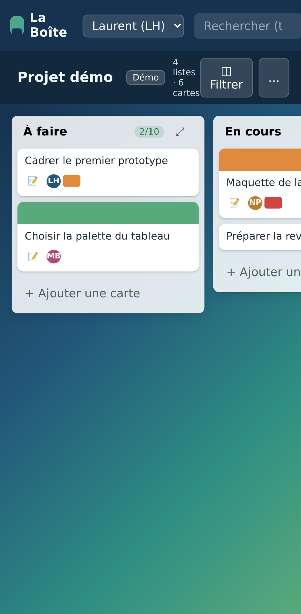

# La Boîte 🗂️

Tableau kanban simple et léger — listes, cartes, étiquettes, échéances — inspiré de l'ergonomie de Trello mais **construit à 100 % de zéro** (aucune ligne de code, d'asset ou de texte récupéré de la plateforme originale).



## Fonctionnalités (v1.6.1)

- **Board** : listes avec compte de cartes et **jeton de limite WIP** (`2/10` — vert, orange, rouge selon le seuil), repli d'une liste (⤢)
- **Cartes** : titre, description (badge 📝), **couverture colorée**, **échéance** (badge orange/rouge si passée, vert si terminée ✓), **étiquettes** (chips colorées, nom au survol), **membres** (initiales colorées)
- **Checklists** (progression + badge `☑ 2/5`), **commentaires** (badge `💬`, mentions `@Prénom`), **journal d'activité** par carte et par tableau
- **Notifications 🔔** : commentaires, mentions, assignations, déplacements — compteur non lus en temps réel
- **Fonds du tableau** (préréglages maison) et **copie de carte** (liste cible, checklists / étiquettes / membres au choix)
- **Pièces jointes** (fichiers ≤ 10 Mo avec aperçu des images, liens), **votes** 👍, **tableaux modèles** et navigation entre plusieurs tableaux
- **Accès par code** : chaque membre se connecte avec son code personnel et peut le changer depuis l'application (clic sur son nom) ; session par cookie `HttpOnly` (30 jours), aucune donnée ni API accessible sans session
- **Glisser-déposer** : cartes entre listes, réordonnancement de cartes ET de listes (positions réelles) ; au doigt sur mobile par appui long
- **Dates** : début et échéance (badge `📅 20 oct. → 5 nov.`)
- **Vues** : Tableau, Calendrier (échéances du mois), Liste triable, Mes cartes (tous tableaux)
- **Checklists assignables** (élément confié à un membre, notifié) · **export CSV** · **compte invité** en lecture seule
- **Raccourcis clavier** : `/` recherche, `n` nouvelle carte, `f` filtre, `?` aide, `Échap` ferme
- **Recherche / filtre** : titre, description, étiquette, membre, commentaire, élément de checklist, échéance
- **Corbeille** : archivage + restauration des cartes et des listes (une liste revient avec toutes ses cartes)
- **Temps réel** : SSE (`/api/board/:id/events`) — une carte créée sur un onglet apparaît instantanément sur les autres, sans rechargement
- **PWA installable** (manifest + service worker, mise hors-ligne des fichiers statiques) + **mode sombre**
- Données locales : SQLite (mode WAL) — aucune donnée ne quitte le serveur

## Stack

Vanilla JS (aucun framework côté client) · Express · better-sqlite3 · service worker minimal · nginx devant le service systemd.

## Lancer en local

```bash
npm install
node scripts/set-code.cjs Laurent        # code aléatoire à 8 chiffres, affiché une seule fois
node scripts/set-code.cjs Marina 12345678   # ou code choisi (6 caractères minimum)
npm start          # http://localhost:3230 (base seedée automatiquement au premier lancement)
```

Sans code défini, un membre ne peut pas se connecter. Compte invité (lecture seule, export compris) : `node scripts/set-code.cjs Invité --guest`. `set-code` ferme aussi les sessions ouvertes du membre (utile en cas de code compromis).

Variables :
- `PORT` (3230 par défaut)
- `SF_TRELLIS_TEST=1` → base de test jetable `/tmp/trello-test.db` (réinitalisée à chaque démarrage)
- `LA_BOITE_INITIAL_CODES="1:code,2:code"` → codes posés au démarrage pour les membres qui n'en ont pas (tests, CI)
- `LA_BOITE_UPLOAD_QUOTA_MB` → quota total des fichiers joints (500 par défaut ; au-delà : `507`)

## Tests

```bash
npm test     # 85 contrôles Playwright (API, UI, SSE, drag&drop, corbeille, checklists, commentaires, notifications…)
CHROMIUM_PATH=/chemin/vers/chrome npm test   # si le Chromium de Playwright n'est pas installé
node scripts/visual-sanity.cjs   # captures + drag de listes + erreurs de page (instance de test jetable)
```

La suite tourne aussi sur GitHub Actions à chaque PR et sur `main` (`.github/workflows/tests.yml`).

## API REST

| Requête | Effet |
|---|---|
| `GET /api/health` | état du service |
| `GET /api/board/:id` | board complet (listes, cartes, étiquettes, membres) |
| `GET /api/boards` · `POST /api/boards` · `PATCH /api/boards/:id` | lister / créer / renommer, changer le fond (`background` ∈ préréglages), marquer modèle (`is_template`) |
| `POST /api/boards/:id/copy` | nouveau tableau depuis un modèle |
| `POST /api/lists` · `PATCH/DELETE /api/lists/:id` · `POST /api/lists/:id/unarchive` | listes (nom, position, WIP, repli) ; `DELETE` = mise à la corbeille, cartes conservées |
| `POST /api/cards` · `PATCH/DELETE /api/cards/:id` | cartes (titre, description, début `start_at` AAAA-MM-JJ, échéance, couverture…) |
| `POST /api/cards/:id/move` | déplacement / réordonnancement |
| `POST /api/cards/:id/labels` · `/members` | rattacher / retirer |
| `POST /api/cards/:id/unarchive` | restaurer depuis la corbeille |
| `GET /api/cards/:id` | détail : checklists, commentaires, activité |
| `POST /api/cards/:id/checklists` · `PATCH/DELETE /api/checklists/:id` | checklists |
| `POST /api/checklists/:id/items` · `PATCH/DELETE /api/checkitems/:id` | éléments (nom, coché, position, `assignee_id`) |
| `POST /api/cards/:id/comments` · `PATCH/DELETE /api/comments/:id` | commentaires |
| `POST /api/cards/:id/copy` | copier une carte |
| `POST /api/cards/:id/attachments` | joindre un fichier (corps brut + `X-File-Name`) ou un lien (`{url}`) |
| `GET /api/attachments/:id/file` · `DELETE /api/attachments/:id` | télécharger / retirer |
| `POST /api/cards/:id/votes` | voter / retirer son vote (`{remove:true}`) |
| `GET /api/board/:id/activity` | journal d'activité du tableau |
| `GET /api/board/:id/export.csv` | export CSV des cartes actives |
| `GET /api/me/cards` | mes cartes (membre ou élément de checklist confié), tous tableaux |
| `GET /api/members/:id/notifications` · `POST …/notifications/read` | notifications 🔔 |
| `GET /api/board/:id/search?q=` | recherche |
| `GET /api/board/:id/events` | flux SSE temps réel |

Connexion : `GET /api/auth/members` (noms pour l'écran de connexion), `POST /api/auth/login` `{member_id, code}`, `POST /api/auth/logout`, `GET /api/auth/me`, `POST /api/auth/code` `{current, next}` (changer son code ; ferme les autres sessions). Toutes les autres routes `/api` exigent la session (`401` sinon) ; l'auteur de chaque action est le membre de la session. Le membre n°1 est l'administrateur (corbeille des cartes et des listes, modération). Toute requête qui modifie doit porter l'en-tête `X-Requested-With: la-boite` (anti-CSRF, `403` sinon). Après 5 codes faux pour un membre depuis une même IP, ce couple est bloqué 15 minutes (`429`) ; plafonds globaux : 50 échecs par membre, 20 par IP.

## Déploiement (VPS)

- Service systemd `la-boite.service` → `/opt/la-boite`, port `3230` ; installer avec `npm ci --omit=dev` (Playwright ne sert qu'aux tests)
- **Codes d'accès** : `cd /opt/la-boite && node scripts/set-code.cjs <membre>` pour chaque membre (à faire avant d'ouvrir l'accès en v1.3.0)
- Fichiers joints dans `/opt/la-boite/uploads/` (à **exclure** du rsync de déploiement, comme `data.db*`, et à inclure dans les sauvegardes)
- nginx : vhost `trello.lhusser.fr` (proxy + `proxy_buffering off` pour le SSE + `no-cache` sur `sw.js`) ; transmettre `X-Forwarded-Proto $scheme` (cookie `Secure`) et `X-Forwarded-For $proxy_add_x_forwarded_for` (sinon le blocage ne se fait que par membre : toutes les requêtes semblent venir de 127.0.0.1)
- HTTPS : Let's Encrypt (certbot, renouvellement automatique)
- Carte sur le portail des apps : terminal.lhusser.fr

## Sauvegardes

```bash
node scripts/backup.cjs                       # → $LA_BOITE_BACKUP_DIR (défaut backups/), rotation 14 jours
node scripts/backup.cjs --dest /var/backups/la-boite --keep-days 30
systemctl stop la-boite
node scripts/restore.cjs /var/backups/la-boite/la-boite-20261017T210000000Z --yes
systemctl start la-boite
```

- Chaque sauvegarde = `data.db` (copie cohérente par l'API SQLite, même service actif), `uploads/`, `manifest.json`
- Automatisation : `deploy/la-boite-backup.service` + `.timer` (horaire) — voir l'en-tête du fichier pour l'installation
- Les sauvegardes contiennent les codes **hachés** et les sessions : dossier en `0700`, à garder hors du web ; copier aussi ailleurs que sur le VPS (une sauvegarde sur le même disque ne protège pas d'une panne disque)
- La restauration vérifie l'empreinte et l'intégrité avant toute écriture et conserve l'ancien état (`*.avant-restauration-…`)

### Copie hors du VPS (chiffrée)

`scripts/offsite.sh` envoie chaque nuit la dernière sauvegarde, chiffrée avec [age](https://age-encryption.org), vers un FTPS (ou tout ce que lftp sait joindre), relit la copie et garde les 7 dernières.

1. Sur **ton poste** (pas sur le serveur) : `age-keygen -o la-boite-age.txt` → garder ce fichier en lieu sûr (gestionnaire de mots de passe + copie hors ligne) ; la ligne `age1…` affichée est la clé publique
2. Sur le VPS : `apt install age lftp`, remplir `/etc/la-boite/offsite.env` d'après `deploy/offsite.env.example` (`chmod 600`), installer `deploy/la-boite-offsite.*` (voir l'en-tête du `.service`)
3. Restaurer depuis la copie distante (sur une machine qui a la clé privée) :
   ```bash
   lftp -u UTILISATEUR -e "set ftp:ssl-force true; get la-boite/la-boite-<horodatage>.tar.gz.age; bye" ftp://HOTE
   mkdir sauvegarde && age -d -i la-boite-age.txt la-boite-<horodatage>.tar.gz.age | tar -xz -C sauvegarde
   node scripts/restore.cjs sauvegarde --yes      # service arrêté
   ```

Sans la clé privée, la copie distante est illisible : la perdre, c'est perdre la sauvegarde hors site.

## Historique

Voir [CHANGELOG.md](CHANGELOG.md).

## Provenance

Reconnaissance de l'ergonomie de référence réalisée avec **REA (Reverse Engineer Anything)** sur le comportement observé uniquement (captures, DOM, graphe applicatif) — le produit ne contient **aucun élément** du site de référence (code, visuels, textes ou marques).

Licence MIT.